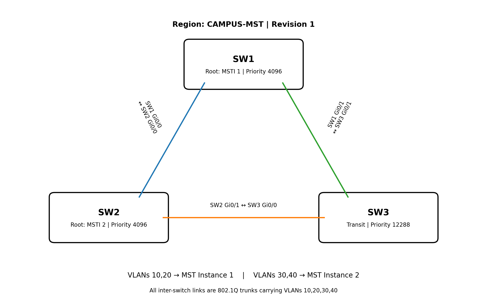

# Topology and addressing

## Switch-to-switch link map

| Link | Side A | Side B | Purpose |
|---|---|---|---|
| 1 | SW1 `Gi0/0` | SW2 `Gi0/0` | Trunk: VLANs 10,20,30,40 |
| 2 | SW2 `Gi0/1` | SW3 `Gi0/0` | Trunk: VLANs 10,20,30,40 |
| 3 | SW3 `Gi0/1` | SW1 `Gi0/1` | Trunk: VLANs 10,20,30,40 |

## Access port plan

| Switch | Port | Access VLAN | Example endpoint |
|---|---|---:|---|
| SW1 | `Gi0/2` | 10 | Host-A |
| SW1 | `Gi0/3` | 30 | Host-B |
| SW2 | `Gi0/2` | 20 | Host-C |
| SW2 | `Gi0/3` | 40 | Host-D |
| SW3 | `Gi0/2` | 10 | Host-E |
| SW3 | `Gi0/3` | 40 | Host-F |

No IP addressing is required on these Layer-2 switches for MST to work. Optional management SVI/IPs may be added if you want to manage and ping the switches, but use unused addresses in a management VLAN and configure a gateway if needed.

## MST region parameters

Every switch must use the exact same values:

- Region name: `CAMPUS-MST`
- Revision: `1`
- Instance 1: VLANs `10,20`
- Instance 2: VLANs `30,40`

Root preference:

- MST instance 1: SW1 has priority 4096; SW2 8192; SW3 12288.
- MST instance 2: SW2 has priority 4096; SW1 8192; SW3 12288.

Lower bridge priority wins, assuming the bridge IDs are compared in the same network. Effective bridge ID also includes the switch MAC address.
