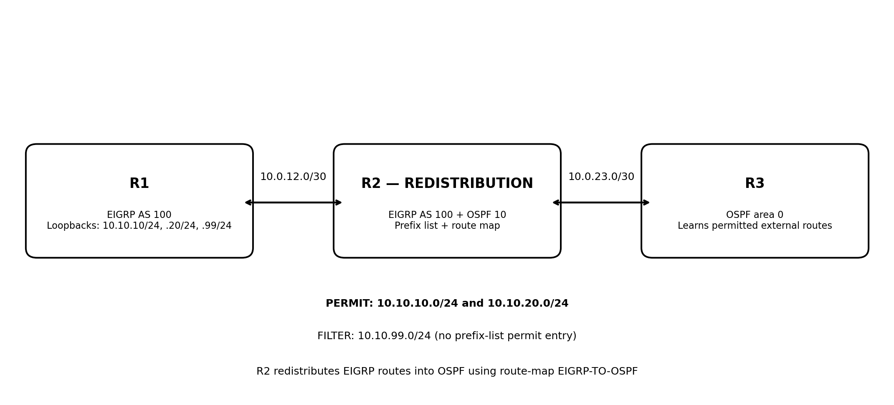

# Topology and addressing

## Topology

- R1 G0/0 connects to R2 G0/0 and runs EIGRP AS 100.
- R2 G0/1 connects to R3 G0/0 and runs OSPF area 0.
- R2 is the redistribution boundary because it participates in both protocols.
- R1 advertises three loopback networks through EIGRP. The prefix list allows two and filters one.

## Addressing table

| Device/interface | Address | Protocol / purpose |
|---|---|---|
| R1 G0/0 | 10.0.12.1/30 | EIGRP AS 100 link |
| R2 G0/0 | 10.0.12.2/30 | EIGRP AS 100 link |
| R2 G0/1 | 10.0.23.2/30 | OSPF area 0 link |
| R3 G0/0 | 10.0.23.3/30 | OSPF area 0 link |
| R1 Loopback10 | 10.10.10.1/24 | Must be redistributed |
| R1 Loopback20 | 10.10.20.1/24 | Must be redistributed |
| R1 Loopback99 | 10.10.99.1/24 | Must be filtered |
| R3 Loopback30 | 192.168.30.1/24 | Local OSPF network |

## EVE-NG setup

1. Add three routers using IOS/IOS XE images that support EIGRP and OSPF.
2. Wire R1 G0/0 to R2 G0/0, and R2 G0/1 to R3 G0/0.
3. Apply each config, adjusting interface names if necessary.
4. For the first pass, avoid adding extra route redistribution or static routes; keep the test focused on the prefix-list policy.
