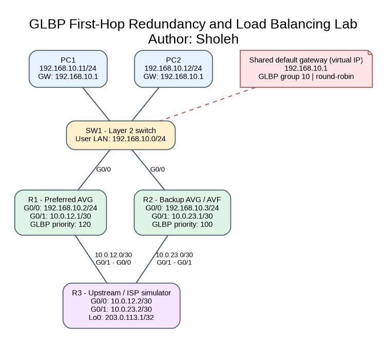

# GLBP Lab — Gateway Redundancy and Load Balancing

**Author: Sholeh**

## Project objective

Build a small Cisco routing lab that demonstrates how the Gateway Load Balancing Protocol (GLBP) offers a shared default gateway and distributes host forwarding assignments across two routers.

## Topology at a glance

- LAN: `192.168.10.0/24`
- GLBP group: `10`
- Virtual gateway for both PCs: `192.168.10.1`
- R1: `192.168.10.2/24`, priority `120` (preferred AVG)
- R2: `192.168.10.3/24`, priority `100` (second GLBP member)
- Simulated external destination: `203.0.113.1/32` on R3 Loopback0
- Load-balancing method: `round-robin`

## Folder map

- `01-Topology/` — topology diagram in PNG, SVG and Graphviz DOT formats, plus the addressing table.
- `02-Configs/` — copyable configurations for R1, R2, R3 and PC addressing notes.
- `03-Purpose-Explanations/` — beginner-friendly explanation of roles, purpose and key commands.
- `04-README/` — this project guide.
- `05-Verification/` — ordered show commands, connectivity checks, failover test and troubleshooting.

## Lab requirements

- Two routers that support GLBP on their IOS/IOS XE software.
- One Layer 2 switch.
- Two PCs or simulated hosts.
- One upstream router (R3) to simulate an external destination.
- Cables/links connected as shown in the topology.

**Platform note:** This lab assumes router interfaces named `GigabitEthernet0/0` and `GigabitEthernet0/1`. Adapt names and any syntax differences to your own router image. Some virtual images and simulators do not implement GLBP.

## Suggested build order

1. Create the topology and connect both router LAN interfaces to the same switch/VLAN.
2. Configure R3, then R1 and R2 using files in `02-Configs/`.
3. Configure PC1 and PC2 with the addresses in `PC-Addressing.txt`; both must use `192.168.10.1` as default gateway.
4. Complete `05-Verification/Verification-Checklist.md` from Stage 1 through Stage 5.
5. Save `show glbp` output and ping results as evidence for the GitHub portfolio.

## Key learning outcomes

- Explain the difference between a router's physical interface IP and a GLBP virtual IP.
- Identify the AVG and AVF roles.
- Configure a GLBP group and round-robin load balancing.
- Verify GLBP with show commands and end-to-end connectivity tests.
- Observe gateway role change during router failure.

## Official reference

Cisco, *First Hop Redundancy Protocols Configuration Guide — Configuring GLBP*:
https://www.cisco.com/c/en/us/td/docs/ios-xml/ios/ipapp_fhrp/configuration/xe-16-6/fhp-xe-16-book/fhp-glbp.html

This is a lab example for learning and portfolio demonstration. Validate command support on the platform and software version being used.
