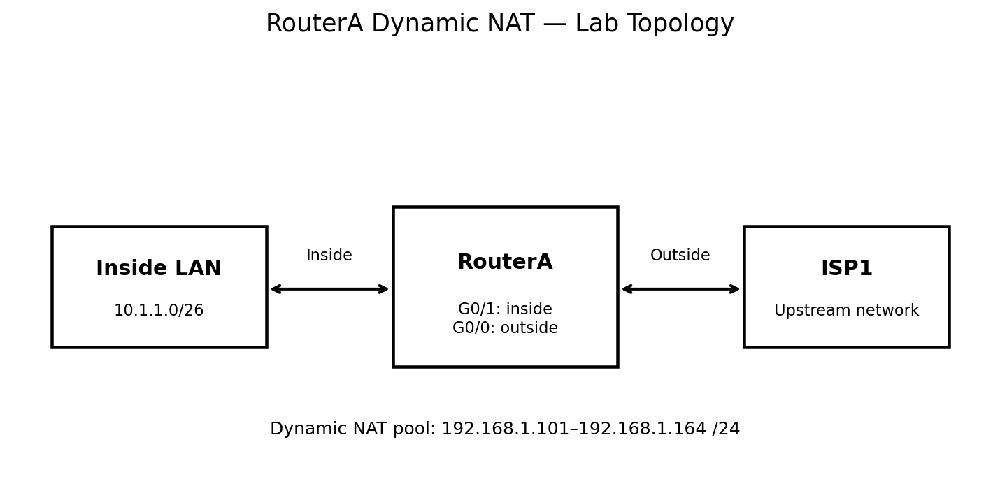

# Topology

- **Inside LAN:** `10.1.1.0/26`
- **RouterA G0/1:** `10.1.1.1/26`, NAT inside
- **RouterA G0/0:** connected to ISP1, NAT outside
- **Dynamic NAT pool:** `exsim`, `192.168.1.101–192.168.1.164`, mask `255.255.255.0`

The ISP-side IP address is intentionally not specified because it is not included in the task.
