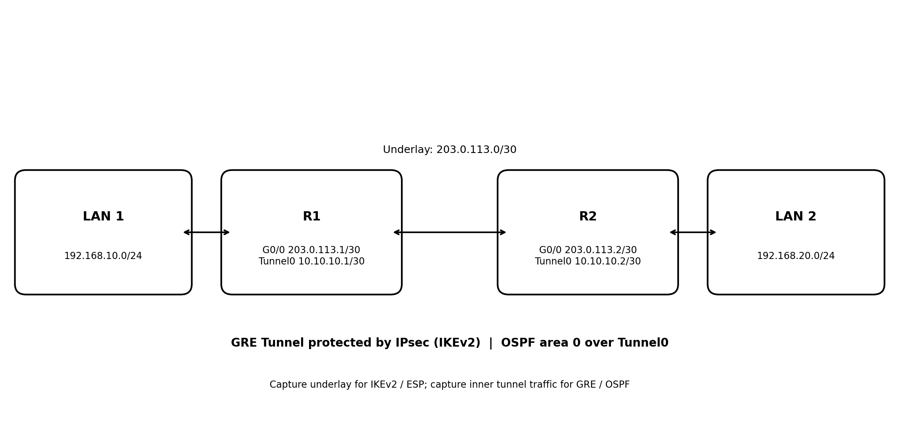

# Topology and addressing



```text
LAN 1                 Underlay link                  LAN 2
192.168.10.0/24                                 192.168.20.0/24
      |                                               |
 R1 G0/1                                         R2 G0/1
 192.168.10.1                                   192.168.20.1
      |                                               |
 R1 G0/0 203.0.113.1/30 =================== 203.0.113.2/30 G0/0 R2
                 GRE Tunnel0 protected by IPsec
             Tunnel0: 10.10.10.1/30 -- 10.10.10.2/30
                         OSPF area 0
```

| Device | Interface | IP address | Role |
|---|---|---|---|
| R1 | G0/0 | 203.0.113.1/30 | Underlay / IKEv2 peer endpoint |
| R2 | G0/0 | 203.0.113.2/30 | Underlay / IKEv2 peer endpoint |
| R1 | G0/1 | 192.168.10.1/24 | LAN 1 gateway |
| R2 | G0/1 | 192.168.20.1/24 | LAN 2 gateway |
| R1 | Tunnel0 | 10.10.10.1/30 | GRE tunnel address |
| R2 | Tunnel0 | 10.10.10.2/30 | GRE tunnel address |

## EVE-NG build steps

1. Add two router nodes with image support for IKEv2, IPsec profiles, GRE, and OSPF.
2. Connect R1 G0/0 to R2 G0/0 using one link.
3. Use G0/1 on each router for a LAN switch/host or use the router interface IPs as sources for initial tests.
4. If your image names interfaces differently, change the interface sections and the Tunnel0 source interface accordingly.
5. Start the nodes and configure both routers.
6. Capture the underlay link for IKE/ESP. To inspect the decrypted/inner traffic, capture at a tunnel-side/pre-encryption point if your setup permits it.

The `203.0.113.0/24` block is a documentation range. Use it only within an isolated lab; substitute another lab subnet if it overlaps your actual environment.
