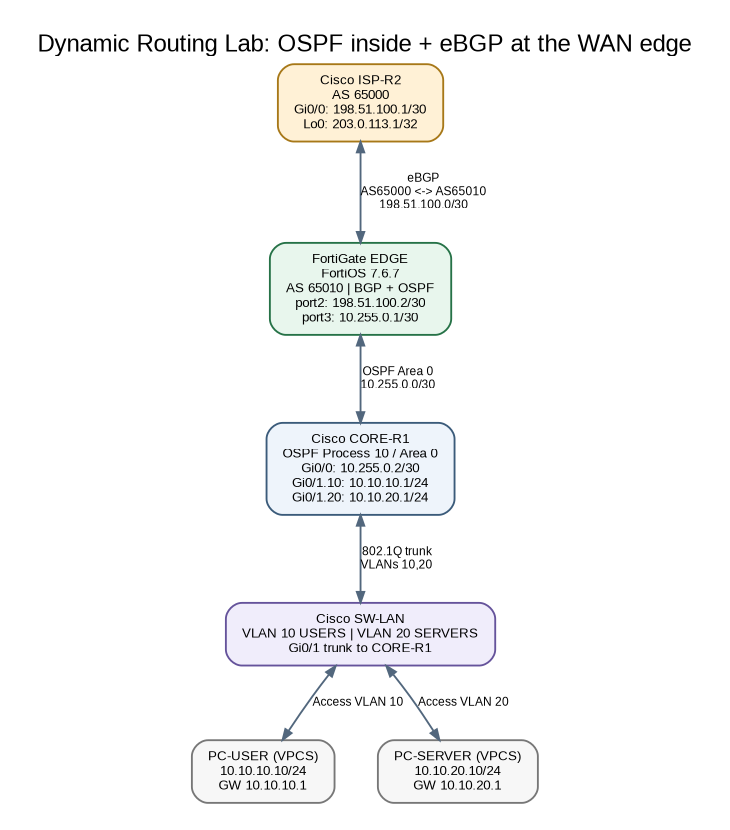

# Dynamic Routing with FortiGate 7.6.7, Cisco OSPF and eBGP

A compact EVE-NG lab showing **OSPF inside an enterprise** and **eBGP at the Internet edge**. The FortiGate learns internal VLAN routes from a Cisco core router, advertises those routes to a simulated ISP, receives an ISP default route using BGP, and injects that default into OSPF for internal clients.

## Learning objectives
- Build a two-VLAN router-on-a-stick LAN with a Cisco Layer-2 switch.
- Establish OSPF Area 0 adjacency between a Cisco router and FortiGate.
- Advertise internal VLAN prefixes through OSPF.
- Establish eBGP between FortiGate AS 65010 and ISP AS 65000.
- Advertise selected internal routes to the ISP with BGP network statements.
- Receive a BGP default route and originate it into OSPF.
- Verify the RIB, BGP table, OSPF neighbor state and end-to-end reachability.
- Troubleshoot routing protocol and route-policy failures.

## Topology

## Nodes
| Node | Role | Suggested image |
|---|---|---|
| FortiGate-EDGE | Firewall, OSPF ASBR, eBGP edge | FortiGate-VM, FortiOS 7.6.7 |
| CORE-R1 | Cisco router-on-a-stick, OSPF | IOSv / CSR1000v / supported IOS-XE router |
| ISP-R2 | Simulated ISP, eBGP peer | IOSv / CSR1000v / supported IOS-XE router |
| SW-LAN | Layer-2 VLAN switch | IOSvL2 / Catalyst image |
| PC-USER | VLAN 10 test client | VPCS |
| PC-SERVER | VLAN 20 test client | VPCS |

## Interface map
- Keep FortiGate `port1` for EVE-NG management if that is how your VM is deployed.
- FortiGate `port2` <-> ISP-R2 `Gi0/0`.
- FortiGate `port3` <-> CORE-R1 `Gi0/0`.
- CORE-R1 `Gi0/1` <-> SW-LAN `Gi0/1` trunk.
- SW-LAN `Fa0/2` <-> PC-USER; `Fa0/3` <-> PC-SERVER.

**Important:** Cisco image interface naming varies. If your image uses different ports, map the links and update interface names in the configuration files before pasting.

## Addressing plan
| Segment | Address | Purpose |
|---|---|---|
| FortiGate port2 - ISP Gi0/0 | 198.51.100.0/30 | eBGP peering; FGT .2, ISP .1 |
| FortiGate port3 - CORE Gi0/0 | 10.255.0.0/30 | OSPF; FGT .1, CORE .2 |
| VLAN 10 | 10.10.10.0/24 | USERS; gateway 10.10.10.1 |
| VLAN 20 | 10.10.20.0/24 | SERVERS; gateway 10.10.20.1 |
| ISP Loopback0 | 203.0.113.1/32 | simulated external destination |

AS numbers: enterprise/FortiGate **65010**; ISP/Cisco **65000**. OSPF process ID on Cisco is **10**; OSPF Area is **0.0.0.0**.

## Routing design
1. CORE-R1 advertises 10.10.10.0/24 and 10.10.20.0/24 to FortiGate through OSPF.
2. FortiGate has BGP network statements for those exact LAN prefixes. It advertises them to the ISP only while the matching routes exist in the FortiGate routing table.
3. ISP-R2 advertises 203.0.113.1/32 and sends a default route to FortiGate with `neighbor 198.51.100.2 default-originate`.
4. FortiGate installs the BGP default route and originates a default into OSPF with `set default-information-originate enable`.
5. CORE-R1 installs the OSPF external default route and forwards external traffic to FortiGate.

No broad OSPF-to-BGP or BGP-to-OSPF redistribution is configured. This lab uses explicit BGP network statements and controlled default origination to make route exchange easier to understand and safer to reason about.

## Build order
1. Add the nodes and connect links according to `topology/topology.png`.
2. Configure SW-LAN using `configs/Cisco-SW1/SW-LAN.txt`.
3. Configure ISP-R2 using `configs/Cisco-ISP-R2/ISP-R2.txt`.
4. Configure CORE-R1 using `configs/Cisco-Core-R1/CORE-R1.txt`.
5. Configure FortiGate-EDGE using `configs/FortiGate/FortiGate-EDGE.conf`.
6. Configure the VPCS nodes using the files in `configs/VPCS/`.
7. Verify in this order: interfaces -> OSPF neighbor -> OSPF routes -> BGP neighbor -> BGP routes -> route table -> ping.

## Expected final state
- FortiGate OSPF neighbor to 10.255.0.2 is FULL.
- FortiGate BGP neighbor 198.51.100.1 is Established.
- FortiGate learns 10.10.10.0/24 and 10.10.20.0/24 through OSPF.
- ISP-R2 learns both internal /24 routes through BGP.
- FortiGate learns 203.0.113.1/32 and 0.0.0.0/0 through BGP.
- CORE-R1 learns 0.0.0.0/0 through OSPF as an external route.
- Both VPCS clients can ping 203.0.113.1.

## Lab-only assumptions and safety
- The IP ranges 198.51.100.0/24 and 203.0.113.0/24 are documentation ranges used for examples. Do not use these as real public ISP addressing.
- The FortiGate policy is deliberately restricted to the simulated test loopback and uses `nat disable`. This lets the lab prove BGP return routing. It is not an Internet-ready security policy.
- The sample policy allows `ALL` services only to the test loopback for simplicity. Tighten it for production.
- Keep your current management interface and backup configuration safe. Confirm FortiGate port names and Cisco interface names before applying.
- Cisco commands are IOS/IOS XE style. Minor syntax and port-name differences may exist across IOSv, CSR1000v and physical platforms.
- The files have been authored and checked for internal consistency but have not been executed against your exact EVE-NG images.

## Files
- `configs/` - complete node configurations.
- `topology/` - PNG, SVG and Graphviz source.
- `tasks/Tasks.md` - practical tasks.
- `tasks/Solutions.md` - exact solution steps and commands.
- `docs/Troubleshooting.md` - symptom-to-check workflow.
- `docs/Interview-Questions.md` - job-market questions and answers.
- `docs/Deployment-Checklist.md` - build and verification checklist.

## References
- Fortinet, FortiOS 7.6.7 Administration Guide - Dynamic Routing: https://docs.fortinet.com/document/fortigate/7.6.7/administration-guide/search
- Fortinet, FortiOS 7.6.7 Administration Guide - BGP: https://docs.fortinet.com/document/fortigate/7.6.7/administration-guide/750736
- Fortinet, FortiOS 7.6.7 CLI Reference: https://docs.fortinet.com/document/fortigate/7.6.7/cli-reference/84566/fortios-cli-reference
- Cisco, IP Routing Configuration Guide - Default Passive Interfaces: https://www.cisco.com/c/en/us/td/docs/routers/ios/config/17-x/ip-routing/b-ip-routing/m_iri-default-passive-interface.html
- Cisco, IP Routing Configuration Guide - BGP: https://www.cisco.com/c/en/us/td/docs/routers/ios-xe/ip-routing/b-ip-routing/m_irg-bgp4.html

## Suggested GitHub repository description
`Hands-on FortiGate 7.6.7 + Cisco OSPF/eBGP lab for enterprise routing, route exchange, default origination and troubleshooting in EVE-NG.`
