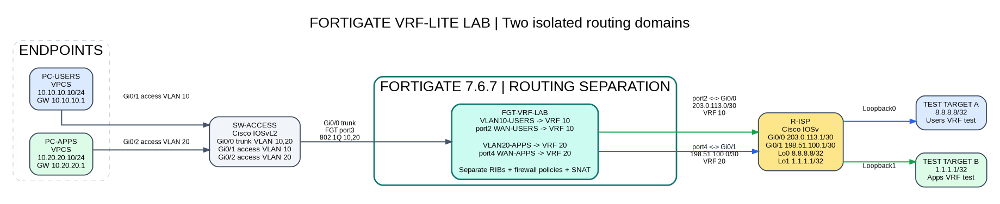

# FortiGate VRF-Lite Enterprise Lab

**FortiOS 7.6.x (target: 7.6.7) | Cisco IOSv Router | Cisco IOSvL2 Switch | EVE-NG**

A small, reproducible enterprise lab that demonstrates two separate routing domains on one FortiGate. It is intended for hands-on job-market preparation and can be used as a GitHub portfolio project.

## What you will learn

- What Virtual Routing and Forwarding (VRF) does and how it differs from VLANs and VDOMs.
- How to assign FortiGate physical and VLAN interfaces to different VRF IDs.
- How connected and static routes are separated between VRF routing tables.
- How a blackhole route can explicitly prevent a remote subnet from being forwarded toward a default route.
- How to apply firewall policies and source NAT independently within each routing domain.
- How to verify the data path using routing tables, logs, packet capture, sessions, and debug flow.
- How to troubleshoot VLAN, route, policy, and NAT failures.

## Scenario

A small enterprise has two departments that must use the same FortiGate but keep their Layer-3 routing domains separate:

- **USERS** uses VLAN 10 and VRF 10.
- **APPS** uses VLAN 20 and VRF 20.

Each routing domain has its own FortiGate WAN interface, default route, firewall policy, and source NAT path. A Cisco IOS router simulates an upstream ISP and provides two loopback addresses as predictable test destinations.

There is deliberately **no route leaking** between VRF 10 and VRF 20. The lab includes reciprocal blackhole routes so cross-department tests are deterministically dropped instead of following a default route.

## Topology



Source diagram: `topology/topology.dot` (Graphviz) and `topology/topology.svg`.

## Device and link map

| Node | Interface | Connects to | Purpose |
|---|---|---|---|
| FGT-VRF-LAB | port1 | Existing management network (not modified) | Preserve out-of-band management |
| FGT-VRF-LAB | port2 | R-ISP Gi0/0 | USERS WAN, VRF 10, 203.0.113.2/30 |
| FGT-VRF-LAB | port3 | SW-ACCESS Gi0/0 | 802.1Q trunk, VLANs 10 and 20 |
| FGT-VRF-LAB | port4 | R-ISP Gi0/1 | APPS WAN, VRF 20, 198.51.100.2/30 |
| SW-ACCESS | Gi0/1 | PC-USERS | Access VLAN 10 |
| SW-ACCESS | Gi0/2 | PC-APPS | Access VLAN 20 |
| R-ISP | Loopback0 | Local | Test destination 8.8.8.8/32 |
| R-ISP | Loopback1 | Local | Test destination 1.1.1.1/32 |

> **Important port mapping:** port1 is deliberately reserved because FortiGate VM deployments often use it for management. If your VM uses different physical interface numbering, map the lab links to unused data interfaces and update the FortiGate config before pasting it.

## Addressing plan

| Device / interface | Address | VRF / VLAN |
|---|---|---|
| FGT port2 (WAN-USERS) | 203.0.113.2/30 | VRF 10 |
| R-ISP Gi0/0 | 203.0.113.1/30 | Global upstream |
| FGT VLAN10-USERS | 10.10.10.1/24 | VLAN 10 / VRF 10 |
| PC-USERS | 10.10.10.10/24, GW 10.10.10.1 | VLAN 10 |
| FGT port4 (WAN-APPS) | 198.51.100.2/30 | VRF 20 |
| R-ISP Gi0/1 | 198.51.100.1/30 | Global upstream |
| FGT VLAN20-APPS | 10.20.20.1/24 | VLAN 20 / VRF 20 |
| PC-APPS | 10.20.20.10/24, GW 10.20.20.1 | VLAN 20 |
| R-ISP Loopback0 | 8.8.8.8/32 | USERS test target |
| R-ISP Loopback1 | 1.1.1.1/32 | APPS test target |

All addresses are documentation/lab examples. They are not production public addresses.

## Requirements

- One FortiGate VM running FortiOS 7.6.x; guide target is 7.6.7.
- One Cisco IOSv router with two GigabitEthernet interfaces and loopback support.
- One Cisco IOSvL2 switch with at least three GigabitEthernet interfaces.
- Two EVE-NG VPCS nodes.
- Console access to FortiGate and Cisco nodes.

The FortiGate VM must expose at least four interfaces if port1 management is retained and port2/port3/port4 are used for this topology. Interface names can differ by image; adjust the files as required.

## Word lab guide

The complete step-by-step Word guide is included at [`docs/FortiGate_VRF_Lite_Enterprise_Lab_Guide.docx`](docs/FortiGate_VRF_Lite_Enterprise_Lab_Guide.docx). It contains the scenario explanation, topology, interface and routing configuration, verification, expected results, tasks, troubleshooting, and publishing notes.

## Configuration files

| File | Node | Purpose |
|---|---|---|
| `configs/FGT-VRF-LAB.conf` | FortiGate | Interface VRFs, static routes, blackholes, address objects, firewall policies, and policy NAT |
| `configs/R-ISP.cfg` | Cisco IOSv router | Two /30 upstream links and loopback test targets |
| `configs/SW-ACCESS.cfg` | Cisco IOSvL2 | VLANs 10/20, trunk, and access ports |
| `configs/PC-USERS.vpcs` | VPCS | Static USERS host IP and verification commands |
| `configs/PC-APPS.vpcs` | VPCS | Static APPS host IP and verification commands |

## Build order

1. Create and cable the EVE-NG nodes using the topology and link map.
2. Apply `configs/SW-ACCESS.cfg` to SW-ACCESS.
3. Apply `configs/R-ISP.cfg` to R-ISP.
4. On FortiGate, enable **System > Feature Visibility > Advanced Routing**.
5. Apply `configs/FGT-VRF-LAB.conf` from the FortiGate CLI. It changes only port2, port3, port4, two VLAN subinterfaces, routes, address objects, and firewall policies. It leaves port1 untouched.
6. If needed after interface VRF assignment, run `execute router restart` separately from the console. Fortinet uses this command in its 7.6.x VRF example to rebuild routing tables; expect a brief routing interruption.
7. Configure each VPCS node using its `.vpcs` file.
8. Run the test matrix below, then complete `tasks/TASKS.md`.

## Expected test matrix

| Test | Expected result | Explanation |
|---|---|---|
| PC-USERS -> 10.10.10.1 | Pass | USERS gateway on VLAN 10 / VRF 10 |
| PC-USERS -> 8.8.8.8 | Pass | VRF 10 default route + policy + SNAT via port2 |
| PC-APPS -> 10.20.20.1 | Pass | APPS gateway on VLAN 20 / VRF 20 |
| PC-APPS -> 1.1.1.1 | Pass | VRF 20 default route + policy + SNAT via port4 |
| PC-USERS -> 10.20.20.10 | Fail | VRF 10 blackhole route blocks APPS subnet |
| PC-APPS -> 10.10.10.10 | Fail | VRF 20 blackhole route blocks USERS subnet |

## Core FortiGate verification commands

```text
get system status
show system interface
show router static
get router info routing-table all
get router info routing-table static
diagnose ip route list
show firewall policy
diagnose sys session list
```

For a filtered packet-processing trace, see `docs/Troubleshooting.md` and `tasks/SOLUTIONS.md`. Use debug commands carefully and stop them as soon as sufficient evidence has been collected.

## Important design notes

1. **VRF is Layer 3 routing separation.** VLANs separate Layer-2 broadcast domains; VRFs maintain separate Layer-3 routing and forwarding tables.
2. **VRF is not VDOM.** A VDOM is a more complete virtual FortiGate with separate configuration/administration boundaries. A VRF separates routing tables but does not create an independent administrative firewall instance.
3. **VRF is not a firewall policy.** A policy authorizes a flow, while routing determines where a packet can go. An allow policy cannot create a missing route between VRFs.
4. **No route leaking is configured.** Fortinet documents route leaking using advanced routing designs, such as BGP with virtual inter-VDOM links. That is intentionally outside this introductory lab.
5. **This is not an MPLS L3VPN lab.** There is no provider PE, route distinguisher, or route-target exchange.
6. The example uses policy NAT. Check `show system settings` and confirm central NAT is not enabled for this lab configuration. If central NAT is enabled, policy-level `set nat enable` is not the right NAT workflow; adapt to central SNAT maps instead rather than toggling global NAT mode casually.
7. The `ALL` service in each policy is for simple connectivity testing in an isolated lab only. In production, replace it with documented application/service requirements and least-privilege policies.
8. Commands and GUI labels can vary by FortiGate model, VM image, and FortiOS patch. The configuration was prepared from vendor documentation, not executed on your specific VM image. Verify interface names and syntax in your lab before deployment.

## Tasks and solutions

- Tasks: `tasks/TASKS.md`
- Worked solutions: `tasks/SOLUTIONS.md`
- Troubleshooting: `docs/Troubleshooting.md`
- Addressing plan: `docs/Addressing-Plan.md`
- LinkedIn publishing checklist: `docs/Publishing-Checklist.md`

## Official references

- Fortinet, **Virtual routing and forwarding**, FortiOS 7.6.x: <https://docs.fortinet.com/document/fortigate/7.6.6/administration-guide/224629/virtual-routing-and-forwarding>
- Fortinet, **Implementing VRF**, FortiOS 7.6.x: <https://docs.fortinet.com/document/fortigate/7.6.2/administration-guide/752950/implementing-vrf>
- Fortinet, **VRF routing support**, FortiOS 7.6.x: <https://docs.fortinet.com/document/fortigate/7.6.0/administration-guide/509828/vrf-routing-support>
- Fortinet, **config router static**, FortiOS 7.6.6 CLI reference: <https://docs.fortinet.com/document/fortigate/7.6.6/cli-reference/200835411/config-router-static>
- Cisco, **Multi-VRF Support / VRF-Lite**, IOS XE IP Routing Configuration Guide: <https://www.cisco.com/c/en/us/td/docs/routers/ios-xe/ip-routing/b-ip-routing/m_mp-multi-vrf-vrf-lite.html>

The linked official reference pages currently show 7.6.0-7.6.6 versions for the VRF topics searched. The CLI patterns used here are the FortiOS 7.6 family syntax; use the 7.6.7 documentation shipped with your exact build as the final authority for any version-specific variation.

## License and reuse

This educational lab may be adapted for personal study and portfolio use. Remove any credentials, serial numbers, public IP details, or organization-specific information before publishing your own modified version.
