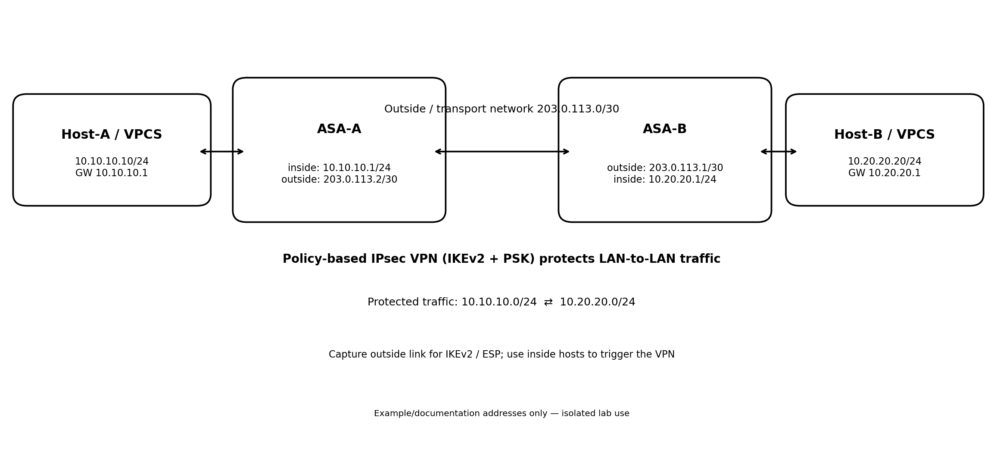

# Topology and addressing



## Topology

```text
Host-A                      ASA-A                         ASA-B                         Host-B
10.10.10.10/24       inside 10.10.10.1              inside 10.20.20.1          10.20.20.20/24
GW 10.10.10.1        outside 203.0.113.2 == WAN == 203.0.113.1 outside          GW 10.20.20.1
                       protected 10.10.10.0/24 <-----> 10.20.20.0/24
```

## Addressing table

| Node | Interface | Address | Purpose |
|---|---|---|---|
| ASA-A | Ethernet0 / outside | `203.0.113.2/30` | VPN transport endpoint |
| ASA-A | Ethernet1 / inside | `10.10.10.1/24` | Local LAN gateway |
| ASA-B | Ethernet0 / outside | `203.0.113.1/30` | VPN transport endpoint |
| ASA-B | Ethernet1 / inside | `10.20.20.1/24` | Remote LAN gateway |
| Host-A | NIC/VPCS | `10.10.10.10/24` | Test host, GW `10.10.10.1` |
| Host-B | NIC/VPCS | `10.20.20.20/24` | Test host, GW `10.20.20.1` |

### EVE-NG cabling

- Connect ASA-A `Ethernet0` and ASA-B `Ethernet0` to the same outside/transport network.
- Connect ASA-A `Ethernet1` to a LAN switch with Host-A.
- Connect ASA-B `Ethernet1` to a LAN switch with Host-B.
- On VPCS, for example: `ip 10.10.10.10/24 10.10.10.1`; on the other host: `ip 10.20.20.20/24 10.20.20.1`.
- For a basic lab, do not add an unrelated NAT/PAT rule. If NAT already exists, follow the NAT-exemption note in the troubleshooting guide.

`203.0.113.0/24` is documentation space; only use it in an isolated lab.
